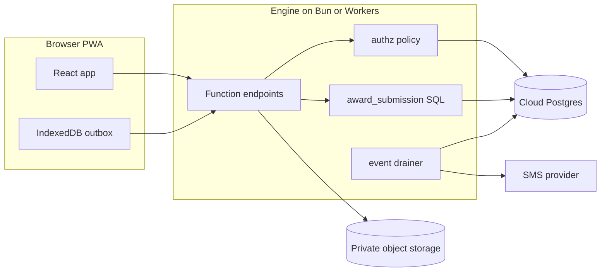

# Ikiraro implementation plan

Status: build plan for the functional blueprint in `docs/Ikiraro_System_Functionalities.md` and the visual system in `docs/ui-design-guidelines.md`.

This plan is the order of work. The functional spec decides what the system must do. The UI guidelines decide how a screen is built. This document decides what lands in which branch, what that branch is allowed to depend on, and which invariants the code has to keep.

162 functional requirements are mapped in Section 8. Nothing in the spec is left unassigned. `FR-INT-07` (mobile money) stays out of scope and has no branch.

---

## 1. How to use this plan

Work one subphase branch at a time. A subphase is done when its acceptance checks pass and `make verify` is green. Merge the subphase into its phase branch. Merge the phase branch into `DEV` when the phase gate in Section 6 passes. `main` stays the release line and is not updated at the end of each phase.

Do not start a subphase whose "Needs" line is still open. Do not pull a later requirement forward because it is nearby in the file. The order protects the trust loop: identity, then content, then learning, then evidence, then an atomic award, then the passport.

Each subphase follows the same engineering loop, because that is how this repository already works:

1. Cut the branch from the phase branch.
2. Add tables to `engine/src/db/schema/` and a Drizzle migration.
3. Add one exported function per folder under `engine/src/api/v1/`.
4. Run `make generate`. Never hand-edit `.generated/` or `openapi.json`.
5. Build the screen from the primitives in `web/src/components/ui/`, using the tokens from the UI guidelines.
6. Call the API through `useEngine` / `useEngineMutation`.
7. Add `index.test.ts` beside the endpoint. Use `useTestEnv()`.
8. Run `make verify`.

Check a box only after that subphase's "Done when" line is true and the branch is on `DEV`. A phase box is checked only when its gate passes.

### Progress

- [x] Phase 0 — Foundations (`phase/0-foundations`)
  - [x] `phase/0.1-design-system`
  - [x] `phase/0.2-data-platform`
  - [x] `phase/0.3-audit-and-events`
  - [x] `phase/0.4-authorization`
  - [x] `phase/0.5-guardrails`
  - [x] `phase/0.6-shells-and-i18n`
- [ ] Phase 1 — Identity and place (`phase/1-identity-and-place`)
  - [x] `phase/1.1-identity-schema`
  - [x] `phase/1.2-phone-and-password-auth`
  - [x] `phase/1.3-registration-consent-profile`
  - [x] `phase/1.4-recovery-and-privacy-requests`
  - [x] `phase/1.5-shared-device-session`
  - [x] `phase/1.6-staff-provisioning`
  - [x] `phase/1.7-geography-and-centers`
- [ ] Phase 2 — Content (`phase/2-content`)
  - [ ] `phase/2.1-content-schema`
  - [ ] `phase/2.2-authoring`
  - [ ] `phase/2.3-review-and-publish`
  - [ ] `phase/2.4-content-versions`
  - [ ] `phase/2.5-rubrics-badges-media`
- [ ] Phase 3 — Learning (`phase/3-learning`)
  - [ ] `phase/3.1-catalog-enrollment`
  - [ ] `phase/3.2-progress-and-prerequisites`
  - [ ] `phase/3.3-learner-home-and-task`
  - [ ] `phase/3.4-audio-and-language`
- [ ] Phase 4 — Trust loop (`phase/4-trust-loop`)
  - [ ] `phase/4.1-private-media`
  - [ ] `phase/4.2-submissions`
  - [ ] `phase/4.3-upload-queue`
  - [ ] `phase/4.4-review-queue`
  - [ ] `phase/4.5-decisions-and-conflicts`
  - [ ] `phase/4.6-atomic-award`
  - [ ] `phase/4.7-resubmit-and-revoke`
- [ ] Phase 5 — Passport and points (`phase/5-passport-and-points`)
  - [ ] `phase/5.1-points-ledger`
  - [ ] `phase/5.2-eligibility-engine`
  - [ ] `phase/5.3-learner-passport`
  - [ ] `phase/5.4-public-verification`
  - [ ] `phase/5.5-manual-adjustments`
- [ ] Phase 6 — Pilot readiness (`phase/6-pilot-readiness`)
  - [ ] `phase/6.1-notification-outbox`
  - [ ] `phase/6.2-sms-production`
  - [ ] `phase/6.3-offline-pwa`
  - [ ] `phase/6.4-audit-and-privacy-tools`
  - [ ] `phase/6.5-misconduct-reports`
  - [ ] `phase/6.6-pilot-operations`
- [ ] Phase 7 — Fairness and hardware (`phase/7-fairness-and-hardware`)
  - [ ] `phase/7.1-review-sla`
  - [ ] `phase/7.2-second-review-and-quality`
  - [ ] `phase/7.3-appeals-and-feedback-library`
  - [ ] `phase/7.4-evidence-integrity`
  - [ ] `phase/7.5-sessions-and-attendance`
  - [ ] `phase/7.6-center-devices-and-directory`
  - [ ] `phase/7.7-inventory`
  - [ ] `phase/7.8-allocation-rounds`
  - [ ] `phase/7.9-committee-decision`
  - [ ] `phase/7.10-handover-and-custody`
  - [ ] `phase/7.11-recovery-and-exceptions`
  - [ ] `phase/7.12-leaderboard-and-equity`
- [ ] Phase 8 — Impact and ecosystem (`phase/8-impact-and-ecosystem`)
  - [ ] `phase/8.1-follow-ups`
  - [ ] `phase/8.2-outcomes-and-surveys`
  - [ ] `phase/8.3-dormancy`
  - [ ] `phase/8.4-mentors`
  - [ ] `phase/8.5-opportunities-and-referrals`
  - [ ] `phase/8.6-mentor-messaging`
  - [ ] `phase/8.7-signed-credentials-and-api`
  - [ ] `phase/8.8-donor-reports`
  - [ ] `phase/8.9-offline-content-packs`
  - [ ] `phase/8.10-maker-checker-and-support`
  - [ ] `phase/8.11-success-stories`
- [ ] Phase 9 — Scale (`phase/9-scale`)
  - [ ] `phase/9.1-pathways-and-placement`
  - [ ] `phase/9.2-peer-and-group-work`
  - [ ] `phase/9.3-scheduled-reports-and-warnings`
  - [ ] `phase/9.4-portable-credentials`
  - [ ] `phase/9.5-coverage-and-tours`
  - [ ] `phase/9.6-remaining-could-haves`
  - [ ] `phase/9.7-account-hardening`

---

## 2. Decisions locked for this build

These replace the open questions in Section 9 of the functional spec.

| Topic | Decision |
| --- | --- |
| Database | Cloud Postgres, accessed only through Drizzle. The engine already picks a driver from `DATABASE_URL`: Neon HTTP when the host is Neon, `postgres.js` otherwise. Schema and migrations stay vendor-neutral so the host can change without a rewrite. |
| Data residency | Unresolved, and it does not block schema design. Before any real learner is stored, confirm Law No. 058/2021 and the donor's rules. If the data must stay in Rwanda, point `DATABASE_URL` at that Postgres. The migrations do not change. |
| Source of truth | Postgres. The browser holds a cache and an outbox. Server state for reviews, points, badges, and grants always wins a conflict. |
| Identity keys | `uuid` primary keys on every new table. The client generates the id when the action can happen offline (submissions, attendance, drafts) so a retry is the same row. Server-generated `uuid` everywhere else. Public URLs use random tokens, never the primary key. |
| Existing starter tables | `users` and `sessions` stay and grow. `todos` is removed in phase 3, when the learner home replaces it. Google OAuth stays until phase 1.2 replaces product login, then those raw routes come out. |
| Passwords | Argon2id via `Bun.password`. `password_hash` is never selected into an API response. |
| Phone | E.164, unique, primary identifier. Rwanda mobile numbers only in v1. |
| Sessions | Keep the starter's model: random token, only the SHA-256 stored, HttpOnly cookie, sliding expiry. Shorten the idle timeout in shared-device mode. |
| Authorization | One policy module, `engine/src/core/authz`. Every handler calls it. Scope is data (`self`, `center`, `district`, `global`), stored on `user_roles`. |
| Immovable writes | Verification rows, point-ledger rows, and audit rows are insert-only. Postgres triggers reject `UPDATE` and `DELETE` on those tables, so a bug in a handler cannot rewrite history. |
| Atomic award | Approving evidence runs one Postgres function, `award_submission(...)`. Task completion, the point entry, hours, and the badge check commit together or not at all. The HTTP driver must not do this as several round-trips. |
| Files | Private object storage behind an `ObjectStore` interface (S3-compatible; Cloudflare R2 is the intended host). The API issues a short-lived signed upload URL. Evidence is read back through a short-lived signed URL. The bucket is not public. |
| SMS | An `SmsSender` interface. Development logs the code. Production uses a provider with a Rwandan sender ID (Africa's Talking is the first adapter) and a second adapter can be added without touching call sites. |
| Email | Same pattern, wired in phase 6. OTP does not depend on email. |
| Notifications | In-app inbox plus SMS. The inbox is loaded by a normal `getNotifications` query. A live socket is not part of the pilot. |
| Domain events | Written in the same database transaction as the change that caused them. A drainer sends notifications. Handlers do not call SMS directly. |
| Languages | `rw` and `en`. UI strings live in dictionaries. Course strings live in `course_translations` and task translation rows. Missing Kinyarwanda falls back to English and is flagged. |
| UI | Paper, ink, and sticker actions from `docs/ui-design-guidelines.md`. One headline and one sticker button per view. Staff density changes; the materials do not. |
| Feature flags | Rows in `config_settings`, audited when changed. Pilot centers can be turned on without a deploy. |
| Payments, native apps, USSD, AI grading | Out of scope. No branch. |

---

## 3. System design

### 3.1 Shape of the running system



The web app never opens Postgres. The engine never trusts a role, a center id, or a score sent by the browser. Object storage never serves evidence on a permanent URL.

Two deployables, matching the starter: `engine` (API) and `web` (static SPA). Sessions stay on the engine host. For production, web and engine share a registrable domain so `COOKIE_SAME_SITE=lax` works. That constraint is already documented in `docs/HOSTING.md`.

### 3.2 Bounded contexts

Each context owns its tables and its folders under `engine/src/api/v1/`. A context may read another context's tables. It writes another context's tables only through an exported function in that context (the award function is the important case).

| Context | Owns | Called by |
| --- | --- | --- |
| Identity | users, credentials, sessions, consents, roles | every other context |
| Geography | provinces, districts, sectors, centers, staff assignment | identity, learning, hardware |
| Content | courses, modules, tasks, translations, rubrics, badges, versions | learning, verification |
| Learning | enrollments, progress | evidence |
| Evidence | submissions, media objects | verification |
| Verification | reviews, appeals, second reviews | ledger, credentials |
| Ledger | point transactions, rules, eligibility | hardware, passport |
| Credentials | passports, earned badges, share tokens | public web |
| Hardware | inventory, rounds, applications, grants, custody | impact |
| Impact | follow-ups, surveys | reporting |
| Mentorship | mentors, matches, opportunities | notifications |
| Notifications | outbox, templates, preferences | the event drainer |
| Compliance | audit log, config, misconduct reports, data requests | every write |

### 3.3 Request path

The starter's runtime stays. A request still flows through request id, CORS, body limits, generated validation, the handler, and the error envelope.

Inside a handler the order is fixed:

1. `requireAuth()` or an explicit anonymous allowance (public passport, OTP request).
2. `authorize(action, resource)` from `engine/src/core/authz`.
3. Load the row with the scope predicate in the SQL (`center_id`, `user_id`), not only a check afterward.
4. Domain checks (conflict of interest, attempt limit, eligibility).
5. One write path: a normal Drizzle write, or a SQL function when several rows must commit together.
6. The write inserts a `domain_events` row in the same transaction.
7. Return a plain typed object. Throw `errors.*` for expected failures.

`getUser()` remains the nullable lookup. Public endpoints do not touch the session table until they need a user.

### 3.4 Authorization

```
roles
  code            learner | trainer | center_manager | district_coordinator
                  | content_author | content_reviewer | hardware_officer
                  | committee_member | auditor | platform_admin | mentor

permissions
  code            submission.review, course.publish, grant.decide, ...

role_permissions
  role_id, permission_id

user_roles
  user_id, role_id, scope_type, scope_id
  scope_type      self | center | district | global
```

A user may hold several roles. The policy unions them. Conflict-of-interest rules are a separate check and apply even when the role would otherwise allow the action: a person cannot review, rank, or approve themselves, a declared relative, or a member of their household.

Auditor and donor access is a read permission on aggregated queries. Those queries suppress groups smaller than 10. They do not gain a back door to learner rows.

Seed the roles in a migration. Do not hard-code a role check as `if (user.role === "trainer")` in a handler. The handler names a permission. The policy decides.

### 3.5 Data conventions

- New tables live in `engine/src/db/schema/<context>.ts` and are re-exported from `schema.ts`, so Drizzle Kit keeps a single schema module.
- Primary key: `uuid` `default gen_random_uuid()`, or supplied by the client when the action is offline-capable.
- Timestamps: `timestamptz`, named `created_at`. No `updated_at` on insert-only tables.
- Soft delete only on `users` (`deleted_at`) and on content (`retired_at`). Evidence, reviews, points, and audit rows are not soft-deleted.
- Enums are Postgres enums or text plus a check constraint. Status strings in TypeScript are the same union the generator can see. No `any`.
- Foreign keys are real. `on delete cascade` is limited to owned children of a user during an anonymization job. Grants, reviews, and ledger rows restrict delete.
- Indexes required from the day the table exists: review queue `(center_id, status, review_due_at)`, ledger `(user_id, created_at)`, public token unique on `digital_passports.public_share_token`, phone unique on `users.phone`.

Insert-only protection, applied in phase 0.3 and repeated for every later ledger-like table:

```sql
create or replace function ikiraro_reject_mutation()
returns trigger language plpgsql as $$
begin
  raise exception 'append-only table % cannot be updated or deleted', tg_table_name;
end $$;
```

### 3.6 The award, the reversal, and the grant

Three operations move trust or property. Each is a Postgres function. Application code calls it and treats the result as the whole outcome.

`award_submission(submission_id, reviewer_id, scores, notes, idempotency_key)`:

1. Lock the submission.
2. Reject if the reviewer is the learner, a declared relative, or outside the center scope.
3. Reject if this idempotency key already committed.
4. Insert `submission_verifications` (immutable).
5. Mark the task attempt approved and the progress row complete.
6. Insert one `point_transactions` row from the current published rule.
7. Add the task's verified minutes to the passport hours.
8. If the badge rule for that course version passes, insert `earned_badges`.
9. Insert `domain_events` (`submission.approved`, and `badge.awarded` when a badge was created).
10. Insert the audit row.

A failure at any step rolls the function back. A retried request with the same idempotency key returns the original result and does not award twice.

`reverse_award(...)` inserts a negative ledger row, marks the verification revoked by inserting a revocation row (the original verification stays), and removes the badge only by inserting a revocation on `earned_badges`. It does not delete the badge row.

`decide_grant(...)` (phase 7) writes the grant, the committee decision, and the inventory status change in one function, with the same idempotency rule.

### 3.7 Events and notifications

`domain_events (id, name, payload, created_at, processed_at, attempts)`.

The drainer runs on a short interval under Bun and on the Worker `scheduled` handler under Cloudflare. It reads unprocessed events, writes notification rows, and sends SMS outside the original request. A failed send increments `attempts` and stays in the outbox. The user sees "queued", never a silent drop.

Event names used by later phases: `user.registered`, `otp.requested`, `submission.created`, `submission.approved`, `submission.needs_revision`, `submission.rejected`, `badge.awarded`, `points.adjusted`, `grant.decided`, `follow_up.due`.

### 3.8 Files

`createUploadIntent` checks auth, type, and the configured byte limit, then returns a signed PUT URL and an object key. The browser compresses images first (target under 400 KB). `createSubmission` stores the key, a content hash, and metadata. Reading evidence calls `createEvidenceUrl`, which returns a URL that expires in minutes.

Allowed types in v1: `image/jpeg`, `image/png`, `image/webp`, `application/pdf`, and a short text body that never goes to object storage. The engine checks the declared type and the object header. It does not trust the file extension.

### 3.9 Offline

Phase 4.3 introduces the outbox shape. Phase 6.3 makes it survive a reload and a closed browser.

- The service worker caches the app shell, published course content the learner has enrolled in, and their own progress.
- Mutations that are allowed offline (draft submission, progress tick, attendance) are written to IndexedDB with a client uuid, then replayed.
- Sync state is a sentence on screen: "3 items waiting to upload."
- Reviews, points, and grants are online-only until phase 8.9 (trainer offline review). If the device is offline, the button explains that.
- Personal data in IndexedDB is encrypted with a key held in memory for the session and dropped on logout. Shared devices must not keep a readable copy after sign-out.

### 3.10 API naming on this generator

The generator in `engine/scripts/generate.ts` rejects a function whose name does not start with an allowed verb. Use these verbs and put the domain in the folder.

| Verb prefix | HTTP | Use |
| --- | --- | --- |
| `get` `list` `find` `search` `fetch` | GET | Reads. Input is the query string. |
| `create` `post` `add` | POST | New records, including login and decisions. |
| `update` `put` | PUT | Replace a draft the user still owns. |
| `patch` `edit` | PATCH | Partial edits of drafts and profiles. |
| `delete` `remove` | DELETE | Withdraw a draft, revoke a session. |

Examples that fit the generator:

| Folder | Function | Route |
| --- | --- | --- |
| `v1/auth/sessions/create` | `createSession` | `POST /api/v1/auth/sessions/create` |
| `v1/auth/otp/create` | `createOtp` | `POST /api/v1/auth/otp/create` |
| `v1/auth/sessions/delete` | `deleteSession` | `DELETE /api/v1/auth/sessions/delete` |
| `v1/verifications/create` | `createVerification` | `POST /api/v1/verifications/create` |
| `v1/reviews/queue` | `getReviewQueue` | `GET /api/v1/reviews/queue` |

`createVerification` is the decision endpoint. The body carries `decision: "approved" | "needs_revision" | "rejected"`. The function calls `award_submission` only for `approved`. Needs-revision and rejected insert a verification and stop. They do not award points.

Input and output types stay concrete. The generator rejects `any` and `unknown`. Dates are `Date` on the server and ISO strings on the client.

Raw routes remain only for provider webhooks (SMS delivery receipts) and anything that is not a JSON function. Uploads do not need a raw route once they use signed URLs.

### 3.11 Web application structure

```
web/src/app/(public)/            home, center directory, passport check
web/src/app/(auth)/              phone, OTP, assisted confirm
web/src/app/(learner)/           home, course, task, passport, applications
web/src/app/(staff)/             review, content, centers, inventory, admin
web/src/components/ui/           Button, Badge, Card, Input, Sheet, Accordion
web/src/components/shell/        wordmark, signed-in bar, sign out
web/src/lib/i18n/                en and rw dictionaries
web/src/lib/offline/             outbox, sync status
```

Route groups do not change the URL. `(learner)` and `(staff)` sit inside the existing protected pattern and add their own layout.

Shell rules from the UI guidelines:

- Public pages may use display type, a marquee of real counts, and poster cards.
- Product pages cap display type at `text-5xl`. The next action is one sticker button, at least 44px tall.
- Status is a labeled pill. Color is never the only signal.
- The signed-in line and sign-out stay visible on every product screen.
- Anton is for a short uppercase line in the active language. Sentences, in Kinyarwanda or English, use Montserrat Alternates.
- Staff tables use paper, meta headers, and a text action on the row. The page still has one sticker for the page's job.

### 3.12 What we keep from the starter

Keep: Bun workspaces, Biome, `make verify`, the generator, the runtime envelope, `errors.*`, request context, hashed sessions, cookie and CORS helpers, Drizzle's lazy `db`, env validation, file-based routes, React Query hooks, and the `(protected)` guard pattern.

Replace over time: Google as the product login, the todo module, Geist, `bg-grid`, `bg-glow`, and the marketing header that links to OpenAPI. OpenAPI stays available to engineers. It leaves the learner header in phase 0.6.

---

## 4. Git model

```
main
 └── phase/0-foundations
      ├── phase/0.1-design-system
      ├── phase/0.2-data-platform
      └── ...
 └── phase/1-identity-and-place
      └── phase/1.2-phone-and-password-auth
```

- `DEV` is the integration line. A finished phase is merged here.
- `main` is the release line. It moves when a release is cut, not at the end of every phase.
- The phase branch is cut from `DEV` when the phase starts.
- The subphase branch is cut from the phase branch.
- Pull request: subphase into the phase branch. One subphase, one review.
- Pull request: phase branch into `DEV` after the phase gate.
- Branch names below are exact. Do not invent a parallel naming scheme.

---

## 5. Phases

### Phase 0 — Foundations

**Branch:** `phase/0-foundations`  
**Gate:** a new endpoint can require a permission, write an audit row and a domain event, and the UI tokens match the guidelines. No learner-facing feature yet.

#### 0.1 Design system

- **Branch:** `phase/0.1-design-system`
- **Needs:** `DEV`
- **Delivers:** `web/src/index.css` tokens from the guidelines (`--canvas`, `--ink`, `--yellow`, poster colors, `--danger`). Fonts: Anton, Montserrat Alternates, Inter Tight, loaded the way Geist is loaded now. `Button` variants `sticker`, `ink`, `quiet`, `destructive`. `Badge` status map. Poster, quiet, and ink `Card`. `shadow-sticker`. Remove `bg-grid` and `bg-glow` from any screen this branch touches.
- **Done when:** the home page is paper and ink, with one sticker, and both themes still read. No raw hex in a component.

#### 0.2 Data platform

- **Branch:** `phase/0.2-data-platform`
- **Needs:** 0.1
- **Delivers:** schema split by file, `uuid` helper, migration workflow documented in this phase's PR (`make db-generate` output is committed; `make db-push` is local only). A short backup and restore runbook for the chosen Postgres host (`FR-ADM-09`). Seed script entry point.
- **Done when:** a fresh database migrates with `make db-migrate`, and the existing starter tests still pass.

#### 0.3 Audit and events

- **Branch:** `phase/0.3-audit-and-events`
- **Needs:** 0.2
- **Delivers:** `system_audit_logs`, `domain_events`, `config_settings`. Insert-only trigger on the audit table. `audit(actor, action, target)` and `emit(name, payload)` helpers that participate in the caller's transaction. Config reads with a version column.
- **Covers:** the mechanism for `FR-ADM-02`, `FR-ADM-04`.
- **Done when:** a test proves an update or delete on `system_audit_logs` raises, and a rolled-back transaction leaves no event behind.

#### 0.4 Authorization

- **Branch:** `phase/0.4-authorization`
- **Needs:** 0.3
- **Delivers:** `roles`, `permissions`, `role_permissions`, `user_roles`. Seed the twelve roles and the permission catalogue (the catalogue grows by migration in later phases). `authorize()` with scope. Tests for self, center, district, global, and a user with two roles.
- **Covers:** `FR-IAM-04`, `NFR-SEC-01`.
- **Done when:** a handler without `authorize` is called out in review, and a trainer scoped to center A cannot pass a check for center B.

#### 0.5 Guardrails

- **Branch:** `phase/0.5-guardrails`
- **Needs:** 0.4
- **Delivers:** `idempotency_keys`, a rate-limit helper (phone, IP, route), feature-flag read from `config_settings`, and a test clock hook. Document the idempotency header handlers will accept: `Idempotency-Key`.
- **Covers:** `NFR-SEC-04`, `NFR-REL-04`, `NFR-MNT-03`.
- **Done when:** the same key returns the stored result and does not run the handler body twice.

#### 0.6 Shells and language

- **Branch:** `phase/0.6-shells-and-i18n`
- **Needs:** 0.1
- **Delivers:** public, auth, learner, and staff layouts. Signed-in slot and sign-out slot. Dictionary loader for `rw` and `en`, with a language switch that does not drop the route. Product header does not show OpenAPI. The product stays on the paper theme.
- **Done when:** a placeholder learner page and a placeholder staff page both show who would be signed in, and a Kinyarwanda string wraps in the body face.

---

### Phase 1 — Identity and place

**Branch:** `phase/1-identity-and-place`  
**Needs:** phase 0 on `DEV`  
**Gate:** a trainer can register a learner at a center, the learner can confirm with an OTP, consent is stored, and a second center cannot see that learner.

**Dev preview:** click the sign-in heading three times, pick a role, then sign in. The same gesture on “Signed in as” switches the role of the account you are already in. Production ignores this.

#### 1.1 Identity schema

- **Branch:** `phase/1.1-identity-schema`
- **Needs:** phase 0
- **Delivers:** extend `users` with phone, `password_hash`, `date_of_birth`, optional `gender`, district, sector, village, economic sector, locale, photo key, `guardian_contact`, `created_by_user_id`, `deleted_at`, `must_change_password`. Tables: `otp_challenges` (hashed code), `consents`, `declared_relationships`, `digital_passports` (empty shell, one per user). Keep starter `sessions`.
- **Done when:** migration applies, phone is unique, and passport id is created with the user in a transaction.

#### 1.2 Phone and password auth

- **Branch:** `phase/1.2-phone-and-password-auth`
- **Needs:** 1.1
- **Delivers:** `SmsSender` plus a dev adapter that logs the code. `createOtp`, `createSession` (password or OTP), `deleteSession`, `getSession`. Rate limit and lockout. Google sign-in stays available beside phone and password. Email verification is deferred. Staff and learners share this login. Email plus password is allowed for staff accounts that have no phone yet. Demo accounts are listed in `docs/demo-accounts.md`.
- **Covers:** `FR-IAM-01` (verify step), `FR-IAM-03`, `FR-INT-01` (port only), `NFR-SEC-02`, `NFR-SEC-04`.
- **UI:** auth recipe. Centered column, large phone and OTP type, one sticker.
- **Done when:** a wrong code locks out, the hash is not in the response, and the session cookie still works with the existing web client.

#### 1.3 Registration, consent, profile

- **Branch:** `phase/1.3-registration-consent-profile`
- **Needs:** 1.2
- **Delivers:** self-registration and assisted registration. Assisted records store the trainer and stay inactive until the learner's OTP. Consent rows for terms, data use, public passport, leaderboard, and mentor contact, each with version and time. Profile read and update. If date of birth is under 18, guardian contact is required and public passport plus mentor contact default to off.
- **Covers:** `FR-IAM-01`, `FR-IAM-02`, `FR-IAM-08`, `FR-IAM-10`, `FR-IAM-11` (capture and defaults), `FR-PAS-01`, part of `FR-ADM-05`.
- **UI:** two-path choice (self or assisted) as an offer, not a feature matrix. Assisted page shows the trainer's name.
- **Done when:** a learner cannot be activated without an OTP, and consent withdrawal writes a new row rather than editing the old one.

#### 1.4 Recovery and privacy requests

- **Branch:** `phase/1.4-recovery-and-privacy-requests`
- **Needs:** 1.3
- **Delivers:** account recovery by OTP. Deactivation. A deletion request that queues anonymization and does not immediately destroy reviews or ledger rows. Those rows keep a tombstone user.
- **Covers:** `FR-IAM-07`, `FR-IAM-12`.
- **Done when:** recovery is rate-limited, and a deletion request is itself an audit event.

#### 1.5 Shared-device session

- **Branch:** `phase/1.5-shared-device-session`
- **Needs:** 1.2, 0.6
- **Delivers:** shared-device flag on the session, idle timeout from config (default 5 minutes), one-tap logout in the shell, no password autofill on those screens, a visible "signed in as" line. List sessions and revoke one (`FR-IAM-06`).
- **Covers:** `FR-IAM-05`, `FR-IAM-06`.
- **Done when:** idle logout clears the client outbox key, and the banner is present on learner and staff layouts.

#### 1.6 Staff provisioning

- **Branch:** `phase/1.6-staff-provisioning`
- **Needs:** 1.5, 0.4
- **Delivers:** admin creates a staff user, assigns roles and scope, forces password change on first login. Deactivate a user. This is `FR-ADM-01` without merge (merge is 9.7).
- **Covers:** `FR-IAM-09` (forced change; two-factor waits for 9.7), `FR-ADM-01`.
- **Done when:** a center manager cannot assign a global admin role, and the new staff user cannot do anything else until the password is changed.

#### 1.7 Geography and centers

- **Branch:** `phase/1.7-geography-and-centers`
- **Needs:** 1.6
- **Delivers:** `provinces`, `districts`, `sectors`, `learning_centers`, `center_staff`. Seed Rwanda's provinces, districts, and sectors. Assign a trainer to several centers and one manager to a center. Learner `center_id` is their home center.
- **Covers:** `FR-CEN-01`, `FR-CEN-03`.
- **Done when:** scope checks use `center_staff`, and a trainer with two centers sees both and no third.

---

### Phase 2 — Content

**Branch:** `phase/2-content`  
**Needs:** phase 1  
**Gate:** a reviewer can publish a course, a learner will later be pinned to that version, and a retired task still resolves for old progress.

#### 2.1 Content schema

- **Branch:** `phase/2.1-content-schema`
- **Needs:** phase 1
- **Delivers:** `courses`, `course_translations`, `modules`, `module_translations`, `tasks`, `task_translations`, `rubric_criteria`, `badges`, `content_versions`. Status: `draft`, `in_review`, `published`, `retired`.

#### 2.2 Authoring

- **Branch:** `phase/2.2-authoring`
- **Needs:** 2.1
- **Delivers:** authors create and edit courses, modules, and tasks in both languages. Evidence type and rubric are required before submit-for-review. English fallback flagged when Kinyarwanda is empty.
- **Covers:** `FR-CMS-01`, `FR-CMS-02`.
- **UI:** form rules. Labels in meta uppercase. One sticker: "Submit for review".

#### 2.3 Review and publish

- **Branch:** `phase/2.3-review-and-publish`
- **Needs:** 2.2
- **Delivers:** reviewer queue, approve or return, publish, retire. Authors cannot publish their own draft. Retired content stays readable.
- **Covers:** `FR-CMS-03`, `BR-12`.

#### 2.4 Content versions

- **Branch:** `phase/2.4-content-versions`
- **Needs:** 2.3
- **Delivers:** publishing writes a `content_versions` snapshot. Later enrollment pins the version. Editing a published course creates the next draft and does not change the snapshot.
- **Covers:** `FR-CMS-04`.
- **Done when:** a test changes a task after publish and the pinned version is unchanged.

#### 2.5 Rubrics, badges, and task media

- **Branch:** `phase/2.5-rubrics-badges-media`
- **Needs:** 2.4, and phase 0.2's storage interface can be a stub until 4.1
- **Delivers:** weighted rubric criteria and a pass threshold. Badge tied to a course version with a rule (all required tasks approved, minimum score, minimum hours). Optional audio, image, and printable job-aid keys on the task. Optional outbound link (Irembo and similar) stored as a URL only.
- **Covers:** `FR-CMS-06`, `FR-CMS-07`, `FR-CMS-08`, `FR-INT-06`.

---

### Phase 3 — Learning

**Branch:** `phase/3-learning`  
**Needs:** phase 2  
**Gate:** a learner can enroll, see the next task in their language, and reach the evidence action. The todo demo is gone.

#### 3.1 Catalog and enrollment

- **Branch:** `phase/3.1-catalog-enrollment`
- **Needs:** phase 2
- **Delivers:** `enrollments`. Published catalog filtered by language, category, sector, and level. Self-enroll and trainer enroll. Enrollment stores start, center, and `content_version_id`.
- **Covers:** `FR-LRN-01`, `FR-LRN-02`.
- **UI:** courses as entity pills or quiet rows, not a card grid of twenty poster cards.

#### 3.2 Progress and prerequisites

- **Branch:** `phase/3.2-progress-and-prerequisites`
- **Needs:** 3.1
- **Delivers:** `module_progress`, `task_progress`. A module may require earlier modules in the pinned version. "What to do next" is a single derived task.
- **Covers:** `FR-LRN-03`, `FR-CMS-05`.

#### 3.3 Learner home and task

- **Branch:** `phase/3.3-learner-home-and-task`
- **Needs:** 3.2, 0.6
- **Delivers:** learner home (next task, one sticker, waiting rows). Task screen: instructions, rubric as a quiet list, evidence action. Remove the todo module, its routes, and its schema.
- **Covers:** `FR-LRN-05` (structure, targets, icons). Audio control lands in 3.4.
- **UI:** learner-home recipe and task recipe.

#### 3.4 Language and audio

- **Branch:** `phase/3.4-audio-and-language`
- **Needs:** 3.3
- **Delivers:** language switch without losing the task. Read-aloud when narration exists. Data-saver: media loads on request. A clarity / "too hard" rating on a task.
- **Covers:** `FR-LRN-04`, `FR-LRN-05`, `FR-CMS-10`, the client half of `FR-OFF-07`.

---

### Phase 4 — Trust loop

**Branch:** `phase/4-trust-loop`  
**Needs:** phase 3  
**Gate:** a real photo can be submitted, a conflicted trainer is blocked, and approval writes the verification, the point row, the hours, and the badge in one commit. A forced failure leaves none of them.

This is the product. Do not open phase 7 while this gate is red.

#### 4.1 Private media

- **Branch:** `phase/4.1-private-media`
- **Needs:** phase 3
- **Delivers:** `ObjectStore`, R2 (or other S3) adapter, `createUploadIntent`, `createEvidenceUrl`. Configured max size, default 10 MB at the door, compressed target under 400 KB. Content hash stored when the submission is finalized.
- **Covers:** `FR-INT-02`, `NFR-SEC-05`, `NFR-SEC-09`, `NFR-PERF-05`.

#### 4.2 Submissions

- **Branch:** `phase/4.2-submissions`
- **Needs:** 4.1
- **Delivers:** `task_submissions` with attempt number, client uuid, timestamp, device info, optional geo, task version, status. Statuses: `draft`, `pending`, `in_review`, `approved`, `needs_revision`, `rejected`, `escalated`, `withdrawn`. History for the learner. Withdraw only before review starts.
- **Covers:** `FR-SUB-01`, `FR-SUB-03`, `FR-SUB-05`, `FR-SUB-11`, `FR-SUB-12`.

#### 4.3 Upload queue

- **Branch:** `phase/4.3-upload-queue`
- **Needs:** 4.2
- **Delivers:** client compression, a simple blur/dark warning, and an outbox that retries a submission after a dropped connection in the same browser session. Durable PWA behavior is 6.3. The payload shape designed here is the one 6.3 will persist.
- **Covers:** `FR-SUB-02`, `FR-SUB-04` (session scope), `FR-SUB-07`.

#### 4.4 Review queue

- **Branch:** `phase/4.4-review-queue`
- **Needs:** 4.2
- **Delivers:** queue for the trainer's centers, oldest first, waiting time visible. Dual-pane review: evidence, then rubric.
- **Covers:** `FR-VER-01`, `FR-VER-02`.
- **UI:** review recipe. Evidence first. Decision slab comes in 4.5.

#### 4.5 Decisions and conflicts

- **Branch:** `phase/4.5-decisions-and-conflicts`
- **Needs:** 4.4, 1.1 relationships
- **Delivers:** `createVerification` for needs-revision (feedback required) and rejected (reason code plus note). Scores per criterion in `verification_scores`. Reviewer id, time, and decision are immutable. Conflict-of-interest block against self and `declared_relationships`.
- **Covers:** `FR-VER-03`, `FR-VER-04`, `FR-VER-06`, `BR-03`, `BR-04`.
- **UI:** ink slab. Approve is green-on-ink and is wired in 4.6. Send back requires a reason in a sheet.

#### 4.6 Atomic award

- **Branch:** `phase/4.6-atomic-award`
- **Needs:** 4.5, 2.5 badge rules
- **Delivers:** `point_transactions` (insert-only), `earned_badges`, hours on the passport. Function `award_submission`. Idempotency key. Domain events for approval and badge.
- **Covers:** `FR-VER-13`, `FR-PTS-01`, `FR-PTS-02` (task, module, course, badge side effects), `NFR-REL-02`, `NFR-REL-04`.
- **Done when:** a test aborts the function mid-way and shows zero rows, and a second call with the same key does not add points.

#### 4.7 Resubmit and revoke

- **Branch:** `phase/4.7-resubmit-and-revoke`
- **Needs:** 4.6
- **Delivers:** up to three further attempts after needs-revision (`BR-05`). The fourth block tells the learner to meet a trainer. `reverse_award` for a coordinator or admin, with a reason, reversing points, hours, and badges by new rows.
- **Covers:** `FR-SUB-10`, `FR-VER-14`, `FR-PTS-05`, `BR-05`, `BR-10` (the revocation half; sanctions workflow is the audit reason plus a role suspension flag).

---

### Phase 5 — Passport and points

**Branch:** `phase/5-passport-and-points`  
**Needs:** phase 4  
**Gate:** a stranger with the share link sees only what the learner opted into, and can tell who verified each badge. The learner can read every point transaction.

#### 5.1 Points ledger

- **Branch:** `phase/5.1-points-ledger`
- **Needs:** phase 4
- **Delivers:** versioned point rules per task, module, and course. Daily and per-type caps. Weight column for difficulty. Learner statement page.
- **Covers:** `FR-PTS-03`, `FR-PTS-06`, `FR-PTS-07`. The table and the award path already exist from 4.6.

#### 5.2 Eligibility engine

- **Branch:** `phase/5.2-eligibility-engine`
- **Needs:** 5.1
- **Delivers:** `evaluateEligibility(user, criteria)` returning pass or fail per criterion (points, badges, hours, attendance, district, months active). Pure function over the ledger and passport, with tests. No hardware UI yet. Attendance criteria return "not enough data" until phase 7.5.
- **Covers:** `FR-PTS-09`.

#### 5.3 Learner passport

- **Branch:** `phase/5.3-learner-passport`
- **Needs:** 5.1
- **Delivers:** the learner's passport: hours, badges with dates, completed tasks, level, points, and a plain-language line per badge.
- **Covers:** `FR-PAS-02`, `FR-PAS-08`.
- **UI:** one headline, badges as labeled pills.

#### 5.4 Public verification

- **Branch:** `phase/5.4-public-verification`
- **Needs:** 5.3, consent flags from 1.3
- **Delivers:** share token, QR target, regenerate (old token dies), per-item visibility, public page with verifier, date, and authority. Printable card (PDF and image) with the QR. No phone, no village, no evidence image unless that item was pinned public.
- **Covers:** `FR-PAS-03`, `FR-PAS-04`, `FR-PAS-05`, `BR-07`, `NFR-SEC-06`, `NFR-PRV-03`.
- **UI:** public passport recipe. Invalid token is a full sentence.
- **Done when:** a token from before regeneration returns not-found, and a minor's public page stays off unless a later, explicit rule allows it.

#### 5.5 Manual adjustments

- **Branch:** `phase/5.5-manual-adjustments`
- **Needs:** 5.1
- **Delivers:** adjustment request plus a second approver, reason required, ledger entries only.
- **Covers:** `FR-PTS-04`, the points half of `FR-ADM-07`.

---

### Phase 6 — Pilot readiness

**Branch:** `phase/6-pilot-readiness`  
**Needs:** phase 5  
**Gate:** the pilot checklist in Section 7. Two or three centers can run on this branch's merge to `main`. Hardware is not required for that pilot.

#### 6.1 Notification outbox

- **Branch:** `phase/6.1-notification-outbox`
- **Needs:** phase 5, events from 0.3
- **Delivers:** `notifications`, `notification_templates`, `notification_preferences`. Drainer. Channels: in-app, SMS, email (email adapter can no-op until credentials exist). Templates in `rw` and `en`, editable by an admin. Events from the spec: submission received, review result, revision requested, badge, points, grant status, follow-up due. Center and district announcements. Stalled-learner reminder uses "one task from the badge" once progress exists.
- **Covers:** `FR-NOT-01`, `FR-NOT-02`, `FR-NOT-03`, `FR-NOT-05`, `FR-NOT-07` (by refresh of the inbox), `FR-LRN-08`, `FR-INT-03`.

#### 6.2 SMS in production

- **Branch:** `phase/6.2-sms-production`
- **Needs:** 6.1, 1.2
- **Delivers:** Africa's Talking adapter, delivery receipts via a raw webhook, retry, per-user daily cap, spend recorded per center. Dev adapter remains the default in test.
- **Covers:** `FR-INT-01`, `FR-NOT-04`, `FR-NOT-06`, `NFR-REL-05`.

#### 6.3 Offline PWA

- **Branch:** `phase/6.3-offline-pwa`
- **Needs:** 4.3, 3.3
- **Delivers:** installable shell, cached course and own progress, durable outbox, visible sync count, server-wins for reviews and points, learner drafts merged or asked. Storage cap, cleanup on logout, encrypted local personal data. Data-saver honored.
- **Covers:** `FR-OFF-01`, `FR-OFF-02`, `FR-OFF-03`, `FR-OFF-04`, `FR-OFF-06`, `FR-OFF-07`.

#### 6.4 Audit and privacy tools

- **Branch:** `phase/6.4-audit-and-privacy-tools`
- **Needs:** phase 5
- **Delivers:** audit search and CSV export scoped to the viewer. Data-subject export, correction, and anonymization job that keeps decision and ledger structure. Optional RLS policies on learner-owned tables, set with `SET LOCAL` inside the request transaction, for submissions, consents, and passports.
- **Covers:** `FR-ADM-03`, `FR-ADM-05`, `FR-ANA-06` (audit export).

#### 6.5 Misconduct reports

- **Branch:** `phase/6.5-misconduct-reports`
- **Needs:** 1.7
- **Delivers:** `reports_misconduct`. A learner or trainer can file a confidential report. It is reviewed by a role outside the reporter's center. The accused center's staff have no permission on the row.
- **Covers:** `FR-SUP-03`. This is a must, so it is in the pilot even though the spec's phase list left it until later.

#### 6.6 Pilot operations

- **Branch:** `phase/6.6-pilot-operations`
- **Needs:** 6.1
- **Delivers:** a small operational view per role: learner next step, trainer queue depth, center health (active learners, waiting submissions, median review time). System health: outbox depth, failed notifications, storage errors. Admin screen for the config keys already in `config_settings`.
- **Covers:** `FR-ANA-01` (pilot slice), `FR-CEN-07` (pilot slice), `FR-ADM-04` (UI), `FR-ADM-08`.

---

### Phase 7 — Fairness and hardware

**Branch:** `phase/7-fairness-and-hardware`  
**Needs:** phase 6 on `DEV`, plus a written allocation policy from a real stakeholder (functional spec, step 5 of Section 14). The software encodes that policy. Do not invent quotas in code that the policy does not state.  
**Gate:** a round can be opened, applicants ranked with a stored formula, a committee decision recorded, a device handed over with a witness, and an outsider can read why.

#### 7.1 Review SLA

- **Branch:** `phase/7.1-review-sla`
- **Needs:** phase 6
- **Delivers:** `review_due_at` from config (default 72 hours). Escalation to the center manager, then the district coordinator. Overdue state on the queue.
- **Covers:** `FR-VER-05`, `BR-11`.

#### 7.2 Second review and trainer quality

- **Branch:** `phase/7.2-second-review-and-quality`
- **Needs:** 7.1
- **Delivers:** `second_reviews`. A configurable fraction of approvals, higher for new trainers, goes to another reviewer. Disagreements are stored. Trainer quality: approval rate, rework rate, median time, disagreement rate. Anomaly flags: points rising too fast, approvals from a single reviewer.
- **Covers:** `FR-VER-07`, `FR-VER-08`, `FR-PTS-08`, `FR-ANA-03`, `BR-06`.

#### 7.3 Appeals and feedback library

- **Branch:** `phase/7.3-appeals-and-feedback-library`
- **Needs:** 7.2
- **Delivers:** `appeals`. One appeal per rejection, decided by a different reviewer. Canned feedback in both languages, insertable and editable.
- **Covers:** `FR-VER-10`, `FR-VER-12`.

#### 7.4 Evidence integrity

- **Branch:** `phase/7.4-evidence-integrity`
- **Needs:** 4.2
- **Delivers:** content-hash duplicate flag, including reuse across learners. Masking tool so the learner can hide a name or an id before upload. In-person verification flag with location and time for badges that require it.
- **Covers:** `FR-SUB-06`, `FR-SUB-08`, `FR-VER-09`.

#### 7.5 Sessions and attendance

- **Branch:** `phase/7.5-sessions-and-attendance`
- **Needs:** 1.7
- **Delivers:** center sessions (topic, course, date, trainer, capacity), learner-visible schedule, attendance by tick-list or QR. Attendance minutes can feed verified hours through the same ledger rules.
- **Covers:** `FR-CEN-04`, `FR-CEN-05`. Unlocks the attendance criterion in the eligibility engine.

#### 7.6 Center devices and directory

- **Branch:** `phase/7.6-center-devices-and-directory`
- **Needs:** 1.7
- **Delivers:** `devices` at the center (condition, availability), practice-slot booking, public center directory with search and a map.
- **Covers:** `FR-CEN-02`, `FR-CEN-06`.

#### 7.7 Inventory

- **Branch:** `phase/7.7-inventory`
- **Needs:** phase 6
- **Delivers:** `hardware_inventory`, `hardware_status_history`. Item, category, serial, condition, status, holding center, donor, acquired date. Per-item eligibility criteria, not hard-coded thresholds.
- **Covers:** `FR-HW-01`, `FR-HW-02`.

#### 7.8 Allocation rounds

- **Branch:** `phase/7.8-allocation-rounds`
- **Needs:** 7.7, 5.2
- **Delivers:** `allocation_rounds`, `round_applications`. A coordinator opens a round for a district with a quantity, a window, and criteria. Learners who pass eligibility can apply with an intended-use statement. The engine stores the per-criterion result on the application.
- **Covers:** `FR-HW-03`, `FR-HW-04`.

#### 7.9 Committee decision

- **Branch:** `phase/7.9-committee-decision`
- **Needs:** 7.8
- **Delivers:** `committee_decisions`, ranking snapshot, `decide_grant` SQL function, `hardware_grants`. Formula is stored on the round. Committee records who decided and why. Quotas, gender and youth targets, and one device per household are inputs of the policy, not constants. Conflict-of-interest block applies to committee members.
- **Covers:** `FR-HW-05`, `FR-HW-06`, `FR-HW-08`, `BR-01`, `BR-08`.

#### 7.10 Handover and custody

- **Branch:** `phase/7.10-handover-and-custody`
- **Needs:** 7.9
- **Delivers:** `handover_records`. Form, recipient acknowledgment by signature image or OTP, photo of device and serial, witness. Every status and location change is a history row from donor to recipient.
- **Covers:** `FR-HW-09`, `FR-HW-10`.

#### 7.11 Recovery and exceptions

- **Branch:** `phase/7.11-recovery-and-exceptions`
- **Needs:** 7.10
- **Delivers:** conditions of award stored with the grant. Recovery flow returning a device to inventory. Exceptions with two approvers, a written reason, and a flag that includes them in the public audit summary.
- **Covers:** `FR-HW-11`, `FR-HW-12`, `FR-HW-16`, `BR-02`.

#### 7.12 Leaderboard and equity

- **Branch:** `phase/7.12-leaderboard-and-equity`
- **Needs:** 7.9, consent from 1.3
- **Delivers:** opt-in board, alias or initials, district, progress toward the threshold. Funnel counts. Equity slices by district, age band, sector, and gender where consent exists. Groups under 10 are hidden. Donor batch list: where each item in a donation went.
- **Covers:** `FR-HW-07`, `FR-HW-14` (batch list), `FR-ANA-01`, `FR-ANA-02`, `FR-ANA-04`, `FR-ANA-06`.

---

### Phase 8 — Impact and ecosystem

**Branch:** `phase/8-impact-and-ecosystem`  
**Needs:** phase 7  
**Gate:** a recipient has 30, 90, and 180 day check-ins on record, and a donor can export a pack with no personal data.

#### 8.1 Follow-ups

- **Branch:** `phase/8.1-follow-ups`
- **Needs:** phase 7
- **Delivers:** `follow_ups` at 30, 90, and 180 days. SMS or in-app check-in. Optional usage evidence reviewed like any other submission.
- **Covers:** `FR-IMP-01`, `FR-IMP-02`, `BR-09`.

#### 8.2 Outcomes and surveys

- **Branch:** `phase/8.2-outcomes-and-surveys`
- **Needs:** 8.1
- **Delivers:** `outcome_surveys`. Baseline at registration completion (can be backfilled), endline later. Income change, services, jobs or customers. Optional trainer verification.
- **Covers:** `FR-IMP-03`, `FR-IMP-05`.

#### 8.3 Dormancy

- **Branch:** `phase/8.3-dormancy`
- **Needs:** 8.1
- **Delivers:** alert to the district coordinator when a recipient stops answering or stops practicing.
- **Covers:** `FR-IMP-04`.

#### 8.4 Mentors

- **Branch:** `phase/8.4-mentors`
- **Needs:** phase 6 consent flags
- **Delivers:** mentor onboarding approved by an admin. Learner opt-in by skill and district. Request and accept, with a weekly contact cap.
- **Covers:** `FR-MEN-01`, `FR-MEN-02`, `FR-MEN-03`.

#### 8.5 Opportunities and referrals

- **Branch:** `phase/8.5-opportunities-and-referrals`
- **Needs:** 8.4
- **Delivers:** `opportunities`, `referrals`. Partners post jobs, apprenticeships, contracts, training. Learners see matches on badges. A trainer referral can be shown on the passport if the learner allows it.
- **Covers:** `FR-MEN-04`, `FR-MEN-05`.

#### 8.6 Mentor messaging

- **Branch:** `phase/8.6-mentor-messaging`
- **Needs:** 8.4
- **Delivers:** in-platform messages, report and block. Contact details stay hidden until both sides agree. Minors require the extra mentor check. Messages are retained.
- **Covers:** `FR-MEN-06`, `FR-MEN-07`, the rest of `FR-IAM-11`.

#### 8.7 Signed credentials and public API

- **Branch:** `phase/8.7-signed-credentials-and-api`
- **Needs:** 5.4
- **Delivers:** each earned badge stores issuer, verifier, date, and a hash signed by a server key. Public API: token in, authenticity and revocation out. Rate-limited.
- **Covers:** `FR-PAS-06`, `FR-INT-04`.

#### 8.8 Donor reports

- **Branch:** `phase/8.8-donor-reports`
- **Needs:** 8.2, 7.12
- **Delivers:** one export: totals, allocation decisions, outcomes, personal data removed. This completes the batch story from 7.12.
- **Covers:** `FR-ANA-05`, `FR-HW-14`.

#### 8.9 Offline content packs and offline review

- **Branch:** `phase/8.9-offline-content-packs`
- **Needs:** 6.3
- **Delivers:** a downloadable course bundle for a center. Trainers can review cached submissions offline; the decision syncs later and keeps the original review time.
- **Covers:** `FR-CMS-11`, `FR-OFF-05`.

#### 8.10 Maker-checker and support

- **Branch:** `phase/8.10-maker-checker-and-support`
- **Needs:** phase 6
- **Delivers:** a general second-approver queue for high-risk admin actions beyond points and grants. Help guides, problem reports, ticket status, printable trainer field guide.
- **Covers:** `FR-ADM-07`, `FR-SUP-01`, `FR-SUP-02`, `FR-SUP-04`, `FR-SUP-06`.

#### 8.11 Success stories

- **Branch:** `phase/8.11-success-stories`
- **Needs:** 8.2
- **Delivers:** consented story and photo that a partner report can include.
- **Covers:** `FR-IMP-06`.

---

### Phase 9 — Scale and polish

**Branch:** `phase/9-scale`  
**Needs:** phase 8  
**Gate:** no must-have requirement is still open. Should and could items below can ship one branch at a time.

| Branch | Delivers | Requirements |
| --- | --- | --- |
| `phase/9.1-pathways-and-placement` | Visual placement check. Ordered pathways ("run a shop", "plan a season"). | `FR-LRN-06`, `FR-LRN-09` |
| `phase/9.2-peer-and-group-work` | Moderated task questions. Group tasks with per-person credit. Practice mode with sample data. | `FR-LRN-07`, `FR-LRN-10`, `FR-LRN-11` |
| `phase/9.3-scheduled-reports-and-warnings` | Emailed scheduled reports. Drop-out and backlog warnings. | `FR-ANA-07`, `FR-ANA-08` |
| `phase/9.4-portable-credentials` | Badge levels and expiry. Open Badges export. Software licence grants with seats and expiry. | `FR-PAS-07`, `FR-PAS-10`, `FR-HW-15` |
| `phase/9.5-coverage-and-tours` | Pop-up tours linked back to a home center. Underserved-sector view. Content templates. | `FR-CEN-08`, `FR-CEN-09`, `FR-CMS-09` |
| `phase/9.6-remaining-could-haves` | Voice-note evidence, bulk review actions, evidence showcase, repair and warranty, satisfaction pulse, partner webhooks. | `FR-SUB-09`, `FR-VER-11`, `FR-PAS-09`, `FR-HW-13`, `FR-SUP-05`, `FR-INT-05` |
| `phase/9.7-account-hardening` | Duplicate detection and admin merge. Optional staff two-factor. Retention jobs (drop images, keep the decision). Session and lockout polish if anything in 1.5 proved thin in the field. | `FR-IAM-09` (second factor), `FR-IAM-13`, `FR-ADM-06` |

USSD, native apps, mobile money, and automatic grading stay out. They need their own design and are not given branches here.

---

## 6. Phase gates

| Phase | Merge to `DEV` when |
| --- | --- |
| 0 | Permission checks, audit trigger, and design tokens are in, and `make verify` passes. |
| 1 | Assisted registration, OTP, consent, and center scope work in tests and in the browser. |
| 2 | A published course has an immutable version. |
| 3 | A learner can open the next task in Kinyarwanda and in English. The todo module is gone. |
| 4 | Award and reversal are atomic and idempotent. A conflicted trainer receives 403. |
| 5 | Public passport hides anything the learner did not opt into. The point statement matches the ledger sum. |
| 6 | Pilot checklist (Section 7) is signed. Real learner data is allowed only after the residency check. |
| 7 | A full round, from open to handover, is reproducible in staging, and every decision has an audit row. |
| 8 | A donor export contains no phone, village, or image. Follow-ups exist for a test grant. |
| 9 | Each subphase is optional and merges on its own when its requirement's acceptance test passes. |

---

## 7. Pilot checklist

Use this at the end of phase 6, at two or three centers, before hardware.

- A new learner finishes registration and a first task with a trainer in under 15 minutes (`NFR-UX-03`).
- The flow works on a mid-range Android phone over a slow connection. First contentful paint under 1.8 s and largest contentful paint under 2.5 s on a 3G profile (`NFR-PERF-01`). The learner route's initial JavaScript stays under 200 KB (`NFR-PERF-02`).
- Kinyarwanda has no dead-end screen (`NFR-UX-05`).
- Shared device: idle logout and one-tap sign-out both work (`FR-IAM-05`).
- Offline: a draft survives airplane mode and shows the waiting count (`FR-OFF-03`).
- A trainer in another center cannot open the submission (`FR-IAM-04`).
- Approving once, with a retried request, creates one point row (`NFR-REL-04`).
- Revocation removes credit by a new ledger row (`FR-VER-14`).
- Public link shows verifier and date, and not the phone number (`FR-PAS-03`).
- Misconduct report is invisible to the reported center (`FR-SUP-03`).
- SMS failure leaves the OTP or notice in a retry queue and tells the user (`NFR-REL-05`).
- Audit log has the registration, the decision, and the export (`FR-ADM-02`).
- Backup restore has been tried on a copy of the database (`FR-ADM-09`).
- A qualified person has confirmed the data-protection obligations for the chosen host (`NFR-PRV-01`).

Success numbers to start recording in phase 6, even before the charts of phase 7: first verified task within 14 days, approval rate, rework rate, median review time, share of decisions with a complete audit row. The rest of Section 13 in the functional spec waits for hardware and follow-up.

---

## 8. Full requirement map

Priority is copied from the functional spec. The branch is where the requirement is finished. A few mechanisms start earlier; the branch named here is the one that makes the requirement true for a user.

### Identity

| ID | Pri | Branch |
| --- | --- | --- |
| FR-IAM-01 | M | `phase/1.3-registration-consent-profile` |
| FR-IAM-02 | M | `phase/1.3-registration-consent-profile` |
| FR-IAM-03 | M | `phase/1.2-phone-and-password-auth` |
| FR-IAM-04 | M | `phase/0.4-authorization` |
| FR-IAM-05 | M | `phase/1.5-shared-device-session` |
| FR-IAM-06 | S | `phase/1.5-shared-device-session` |
| FR-IAM-07 | M | `phase/1.4-recovery-and-privacy-requests` |
| FR-IAM-08 | M | `phase/1.3-registration-consent-profile` |
| FR-IAM-09 | S | `phase/1.6-staff-provisioning` (forced change), `phase/9.7-account-hardening` (second factor) |
| FR-IAM-10 | M | `phase/1.3-registration-consent-profile` |
| FR-IAM-11 | S | `phase/1.3-registration-consent-profile`, completed in `phase/8.6-mentor-messaging` |
| FR-IAM-12 | M | `phase/1.4-recovery-and-privacy-requests` |
| FR-IAM-13 | S | `phase/9.7-account-hardening` |

### Geography and centers

| ID | Pri | Branch |
| --- | --- | --- |
| FR-CEN-01 | M | `phase/1.7-geography-and-centers` |
| FR-CEN-02 | S | `phase/7.6-center-devices-and-directory` |
| FR-CEN-03 | M | `phase/1.7-geography-and-centers` |
| FR-CEN-04 | S | `phase/7.5-sessions-and-attendance` |
| FR-CEN-05 | S | `phase/7.5-sessions-and-attendance` |
| FR-CEN-06 | S | `phase/7.6-center-devices-and-directory` |
| FR-CEN-07 | S | `phase/6.6-pilot-operations` |
| FR-CEN-08 | C | `phase/9.5-coverage-and-tours` |
| FR-CEN-09 | C | `phase/9.5-coverage-and-tours` |

### Content

| ID | Pri | Branch |
| --- | --- | --- |
| FR-CMS-01 | M | `phase/2.2-authoring` |
| FR-CMS-02 | M | `phase/2.2-authoring` |
| FR-CMS-03 | M | `phase/2.3-review-and-publish` |
| FR-CMS-04 | M | `phase/2.4-content-versions` |
| FR-CMS-05 | S | `phase/3.2-progress-and-prerequisites` |
| FR-CMS-06 | M | `phase/2.5-rubrics-badges-media` |
| FR-CMS-07 | S | `phase/2.5-rubrics-badges-media` |
| FR-CMS-08 | M | `phase/2.5-rubrics-badges-media` |
| FR-CMS-09 | C | `phase/9.5-coverage-and-tours` |
| FR-CMS-10 | S | `phase/3.4-audio-and-language` |
| FR-CMS-11 | S | `phase/8.9-offline-content-packs` |

### Learning

| ID | Pri | Branch |
| --- | --- | --- |
| FR-LRN-01 | M | `phase/3.1-catalog-enrollment` |
| FR-LRN-02 | M | `phase/3.1-catalog-enrollment` |
| FR-LRN-03 | M | `phase/3.2-progress-and-prerequisites` |
| FR-LRN-04 | M | `phase/3.4-audio-and-language` |
| FR-LRN-05 | M | `phase/3.3-learner-home-and-task` |
| FR-LRN-06 | S | `phase/9.1-pathways-and-placement` |
| FR-LRN-07 | C | `phase/9.2-peer-and-group-work` |
| FR-LRN-08 | S | `phase/6.1-notification-outbox` |
| FR-LRN-09 | S | `phase/9.1-pathways-and-placement` |
| FR-LRN-10 | C | `phase/9.2-peer-and-group-work` |
| FR-LRN-11 | C | `phase/9.2-peer-and-group-work` |

### Evidence

| ID | Pri | Branch |
| --- | --- | --- |
| FR-SUB-01 | M | `phase/4.2-submissions` |
| FR-SUB-02 | M | `phase/4.3-upload-queue` |
| FR-SUB-03 | M | `phase/4.2-submissions` |
| FR-SUB-04 | M | `phase/4.3-upload-queue`, durable in `phase/6.3-offline-pwa` |
| FR-SUB-05 | M | `phase/4.2-submissions` |
| FR-SUB-06 | S | `phase/7.4-evidence-integrity` |
| FR-SUB-07 | S | `phase/4.3-upload-queue` |
| FR-SUB-08 | S | `phase/7.4-evidence-integrity` |
| FR-SUB-09 | C | `phase/9.6-remaining-could-haves` |
| FR-SUB-10 | M | `phase/4.7-resubmit-and-revoke` |
| FR-SUB-11 | M | `phase/4.2-submissions` |
| FR-SUB-12 | S | `phase/4.2-submissions` |

### Verification

| ID | Pri | Branch |
| --- | --- | --- |
| FR-VER-01 | M | `phase/4.4-review-queue` |
| FR-VER-02 | M | `phase/4.4-review-queue` |
| FR-VER-03 | M | `phase/4.5-decisions-and-conflicts` |
| FR-VER-04 | M | `phase/4.5-decisions-and-conflicts` |
| FR-VER-05 | S | `phase/7.1-review-sla` |
| FR-VER-06 | M | `phase/4.5-decisions-and-conflicts` |
| FR-VER-07 | S | `phase/7.2-second-review-and-quality` |
| FR-VER-08 | S | `phase/7.2-second-review-and-quality` |
| FR-VER-09 | S | `phase/7.4-evidence-integrity` |
| FR-VER-10 | S | `phase/7.3-appeals-and-feedback-library` |
| FR-VER-11 | C | `phase/9.6-remaining-could-haves` |
| FR-VER-12 | S | `phase/7.3-appeals-and-feedback-library` |
| FR-VER-13 | M | `phase/4.6-atomic-award` |
| FR-VER-14 | M | `phase/4.7-resubmit-and-revoke` |

### Passport

| ID | Pri | Branch |
| --- | --- | --- |
| FR-PAS-01 | M | `phase/1.3-registration-consent-profile` |
| FR-PAS-02 | M | `phase/5.3-learner-passport` |
| FR-PAS-03 | M | `phase/5.4-public-verification` |
| FR-PAS-04 | M | `phase/5.4-public-verification` |
| FR-PAS-05 | S | `phase/5.4-public-verification` |
| FR-PAS-06 | S | `phase/8.7-signed-credentials-and-api` |
| FR-PAS-07 | C | `phase/9.4-portable-credentials` |
| FR-PAS-08 | S | `phase/5.3-learner-passport` |
| FR-PAS-09 | C | `phase/9.6-remaining-could-haves` |
| FR-PAS-10 | C | `phase/9.4-portable-credentials` |

### Points

| ID | Pri | Branch |
| --- | --- | --- |
| FR-PTS-01 | M | `phase/4.6-atomic-award` |
| FR-PTS-02 | M | `phase/4.6-atomic-award` |
| FR-PTS-03 | S | `phase/5.1-points-ledger` |
| FR-PTS-04 | M | `phase/5.5-manual-adjustments` |
| FR-PTS-05 | M | `phase/4.7-resubmit-and-revoke` |
| FR-PTS-06 | S | `phase/5.1-points-ledger` |
| FR-PTS-07 | M | `phase/5.1-points-ledger` |
| FR-PTS-08 | S | `phase/7.2-second-review-and-quality` |
| FR-PTS-09 | M | `phase/5.2-eligibility-engine` |

### Hardware

| ID | Pri | Branch |
| --- | --- | --- |
| FR-HW-01 | M | `phase/7.7-inventory` |
| FR-HW-02 | M | `phase/7.7-inventory` |
| FR-HW-03 | M | `phase/7.8-allocation-rounds` |
| FR-HW-04 | M | `phase/7.8-allocation-rounds` |
| FR-HW-05 | M | `phase/7.9-committee-decision` |
| FR-HW-06 | S | `phase/7.9-committee-decision` |
| FR-HW-07 | S | `phase/7.12-leaderboard-and-equity` |
| FR-HW-08 | M | `phase/7.9-committee-decision` |
| FR-HW-09 | M | `phase/7.10-handover-and-custody` |
| FR-HW-10 | M | `phase/7.10-handover-and-custody` |
| FR-HW-11 | S | `phase/7.11-recovery-and-exceptions` |
| FR-HW-12 | S | `phase/7.11-recovery-and-exceptions` |
| FR-HW-13 | C | `phase/9.6-remaining-could-haves` |
| FR-HW-14 | S | `phase/7.12-leaderboard-and-equity` and `phase/8.8-donor-reports` |
| FR-HW-15 | C | `phase/9.4-portable-credentials` |
| FR-HW-16 | S | `phase/7.11-recovery-and-exceptions` |

### Impact, mentorship, notifications

| ID | Pri | Branch |
| --- | --- | --- |
| FR-IMP-01 | S | `phase/8.1-follow-ups` |
| FR-IMP-02 | S | `phase/8.1-follow-ups` |
| FR-IMP-03 | S | `phase/8.2-outcomes-and-surveys` |
| FR-IMP-04 | S | `phase/8.3-dormancy` |
| FR-IMP-05 | S | `phase/8.2-outcomes-and-surveys` |
| FR-IMP-06 | C | `phase/8.11-success-stories` |
| FR-MEN-01 | S | `phase/8.4-mentors` |
| FR-MEN-02 | S | `phase/8.4-mentors` |
| FR-MEN-03 | S | `phase/8.4-mentors` |
| FR-MEN-04 | C | `phase/8.5-opportunities-and-referrals` |
| FR-MEN-05 | C | `phase/8.5-opportunities-and-referrals` |
| FR-MEN-06 | C | `phase/8.6-mentor-messaging` |
| FR-MEN-07 | S | `phase/8.6-mentor-messaging` |
| FR-NOT-01 | M | `phase/6.1-notification-outbox` |
| FR-NOT-02 | M | `phase/6.1-notification-outbox` |
| FR-NOT-03 | S | `phase/6.1-notification-outbox` |
| FR-NOT-04 | S | `phase/6.2-sms-production` |
| FR-NOT-05 | S | `phase/6.1-notification-outbox` |
| FR-NOT-06 | S | `phase/6.2-sms-production` |
| FR-NOT-07 | S | `phase/6.1-notification-outbox` |

### Analytics, admin, support, integrations, offline

| ID | Pri | Branch |
| --- | --- | --- |
| FR-ANA-01 | M | `phase/6.6-pilot-operations`, widened in `phase/7.12-leaderboard-and-equity` |
| FR-ANA-02 | M | `phase/7.12-leaderboard-and-equity` |
| FR-ANA-03 | S | `phase/7.2-second-review-and-quality` |
| FR-ANA-04 | S | `phase/7.12-leaderboard-and-equity` |
| FR-ANA-05 | S | `phase/8.8-donor-reports` |
| FR-ANA-06 | S | `phase/6.4-audit-and-privacy-tools` |
| FR-ANA-07 | C | `phase/9.3-scheduled-reports-and-warnings` |
| FR-ANA-08 | C | `phase/9.3-scheduled-reports-and-warnings` |
| FR-ADM-01 | M | `phase/1.6-staff-provisioning` |
| FR-ADM-02 | M | `phase/0.3-audit-and-events` |
| FR-ADM-03 | S | `phase/6.4-audit-and-privacy-tools` |
| FR-ADM-04 | M | `phase/0.3-audit-and-events` (store), `phase/6.6-pilot-operations` (screen) |
| FR-ADM-05 | M | `phase/6.4-audit-and-privacy-tools` |
| FR-ADM-06 | S | `phase/9.7-account-hardening` |
| FR-ADM-07 | S | `phase/5.5-manual-adjustments`, `phase/7.11-recovery-and-exceptions`, `phase/8.10-maker-checker-and-support` |
| FR-ADM-08 | S | `phase/6.6-pilot-operations` |
| FR-ADM-09 | S | `phase/0.2-data-platform` |
| FR-SUP-01 | S | `phase/8.10-maker-checker-and-support` |
| FR-SUP-02 | S | `phase/8.10-maker-checker-and-support` |
| FR-SUP-03 | M | `phase/6.5-misconduct-reports` |
| FR-SUP-04 | C | `phase/8.10-maker-checker-and-support` |
| FR-SUP-05 | C | `phase/9.6-remaining-could-haves` |
| FR-SUP-06 | S | `phase/8.10-maker-checker-and-support` |
| FR-INT-01 | M | `phase/1.2-phone-and-password-auth`, production in `phase/6.2-sms-production` |
| FR-INT-02 | M | `phase/4.1-private-media` |
| FR-INT-03 | S | `phase/6.1-notification-outbox` |
| FR-INT-04 | S | `phase/8.7-signed-credentials-and-api` |
| FR-INT-05 | C | `phase/9.6-remaining-could-haves` |
| FR-INT-06 | S | `phase/2.5-rubrics-badges-media` |
| FR-INT-07 | C | Out of scope. No branch. |
| FR-OFF-01 | M | `phase/6.3-offline-pwa` |
| FR-OFF-02 | M | `phase/6.3-offline-pwa` |
| FR-OFF-03 | M | `phase/6.3-offline-pwa` |
| FR-OFF-04 | M | `phase/6.3-offline-pwa` |
| FR-OFF-05 | S | `phase/8.9-offline-content-packs` |
| FR-OFF-06 | S | `phase/6.3-offline-pwa` |
| FR-OFF-07 | S | `phase/6.3-offline-pwa` |

### Business rules

| ID | Where it becomes true |
| --- | --- |
| BR-01 | `phase/7.9-committee-decision` |
| BR-02 | `phase/7.11-recovery-and-exceptions` |
| BR-03 | `phase/4.5-decisions-and-conflicts`, applied again in 7.9 |
| BR-04 | `phase/0.3-audit-and-events` and every insert-only table after it |
| BR-05 | `phase/4.7-resubmit-and-revoke` |
| BR-06 | `phase/7.2-second-review-and-quality` |
| BR-07 | `phase/1.3-registration-consent-profile` and `phase/5.4-public-verification` |
| BR-08 | `phase/7.9-committee-decision` |
| BR-09 | `phase/8.1-follow-ups` |
| BR-10 | `phase/4.7-resubmit-and-revoke` |
| BR-11 | `phase/7.1-review-sla` |
| BR-12 | `phase/2.3-review-and-publish` |

---

## 9. Non-functional work, by phase

| NFR | Where |
| --- | --- |
| NFR-PERF-01, 02, 05 | Measured at the phase 6 gate. Compression in 4.3. Budgets enforced on the learner route. |
| NFR-PERF-03 | Inbox refresh in 6.1. |
| NFR-PERF-04 | Document connection pooling and read replicas when the pilot numbers exist. Not a code branch before then. |
| NFR-SEC-01 | 0.4, plus RLS in 6.4 |
| NFR-SEC-02 | 1.2 |
| NFR-SEC-03 | Host TLS and disk encryption of the Postgres provider. Note in the 0.2 runbook. |
| NFR-SEC-04 | 0.5 and 1.2 |
| NFR-SEC-05, 09 | 4.1 |
| NFR-SEC-06 | 5.4 |
| NFR-SEC-07 | Existing env validation. No secrets in git. |
| NFR-SEC-08 | Dependency review on the phase PR, using the CI already described in `docs/HOSTING.md`. |
| NFR-PRV-01 | Gate before real data, phase 6 |
| NFR-PRV-02, 03, 04 | 1.3, 5.4, 7.12 |
| NFR-PRV-05 | A one-page breach plan in the phase 6 PR. |
| NFR-REL-01 | Host monitoring in 6.6 |
| NFR-REL-02, 04 | 4.6 |
| NFR-REL-03 | 0.2 runbook, restore tested before pilot |
| NFR-REL-05 | 6.2 |
| NFR-UX-01, 02 | UI guidelines, checked on every product PR |
| NFR-UX-03, 05 | Phase 6 field test |
| NFR-UX-04 | After the pilot, not a branch |
| NFR-OBS-01 | Starter logs plus the `onError` hook in `engine/src/app.ts`. Wire the error tracker in 6.6. |
| NFR-MNT-01, 02 | `make verify`, migrations from 0.2 onward |
| NFR-MNT-03 | 0.5 |

---

## 10. Suggested first branch

Start with `phase/0-foundations` cut from `DEV`, then `phase/0.1-design-system`.

That branch only changes tokens, fonts, and primitives. It does not change the database or auth. It gives every later screen one set of materials, which is what the UI guidelines require before product pages are built.
